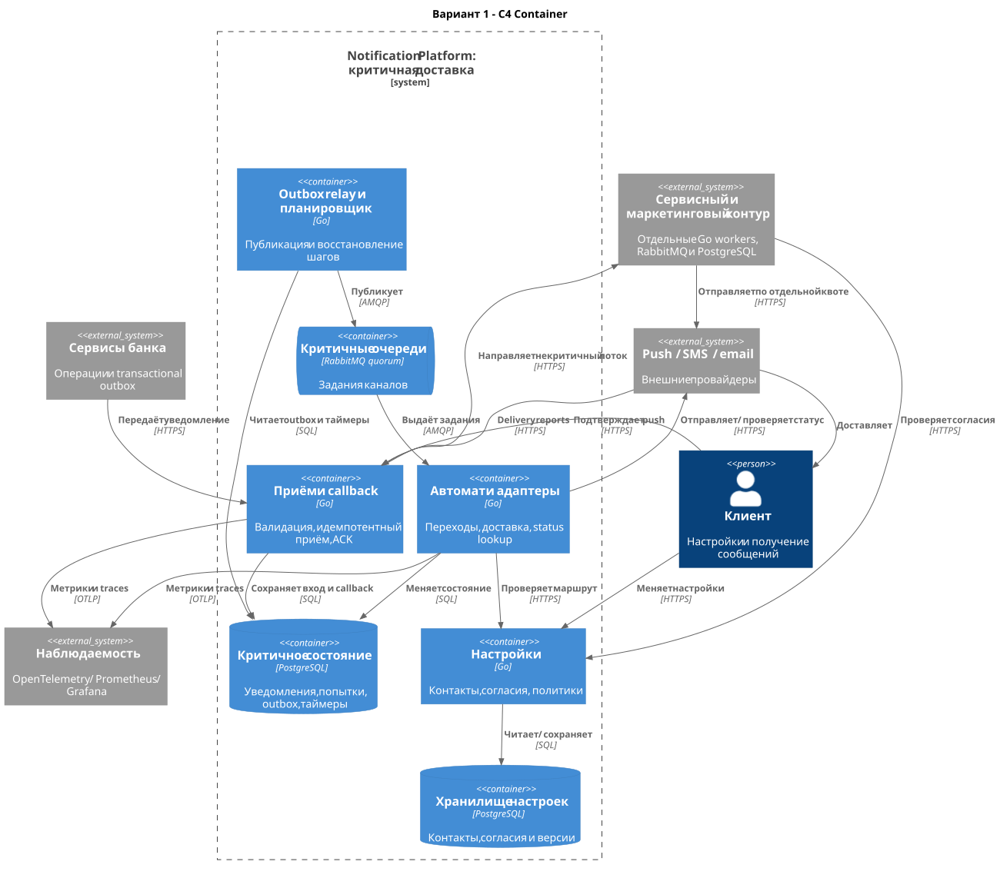
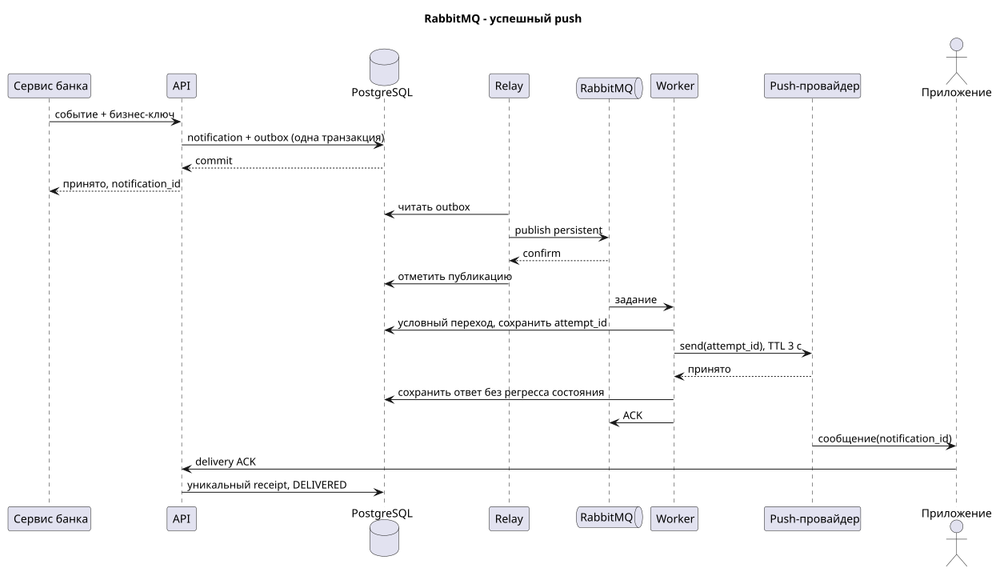
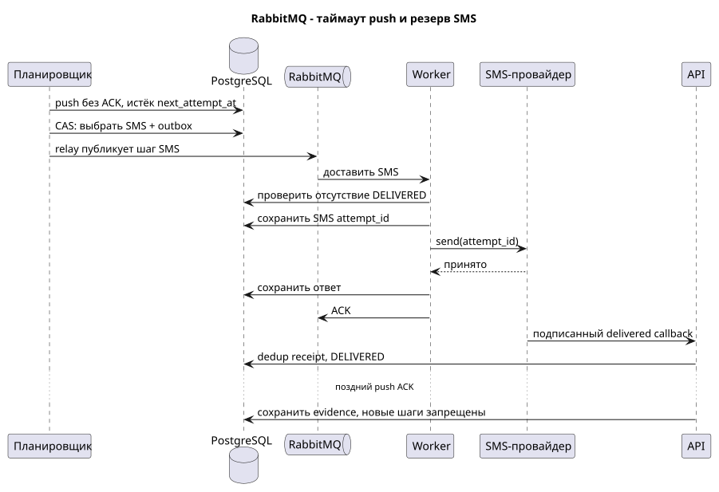
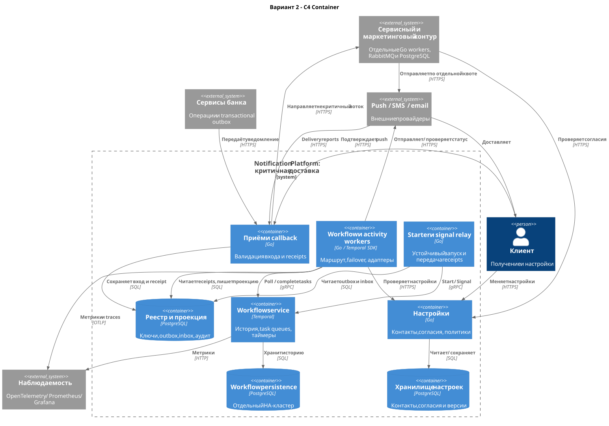
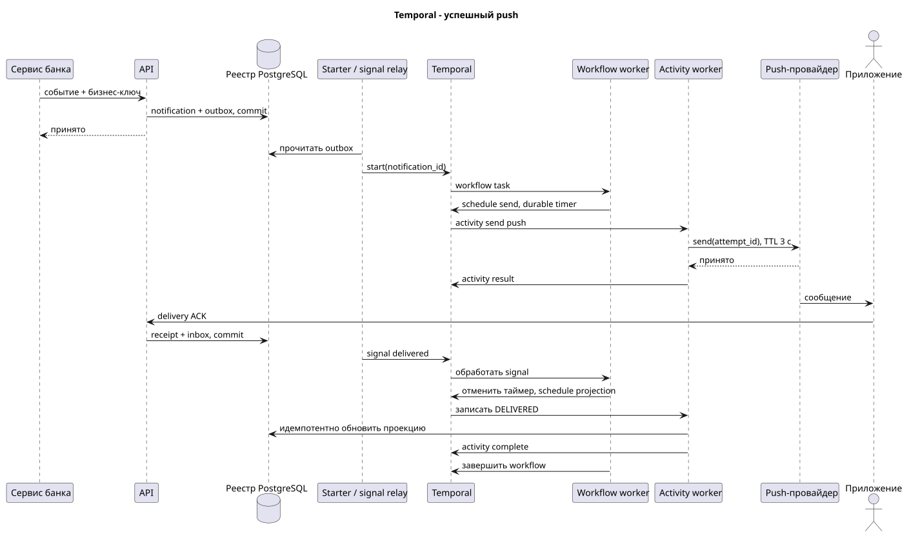
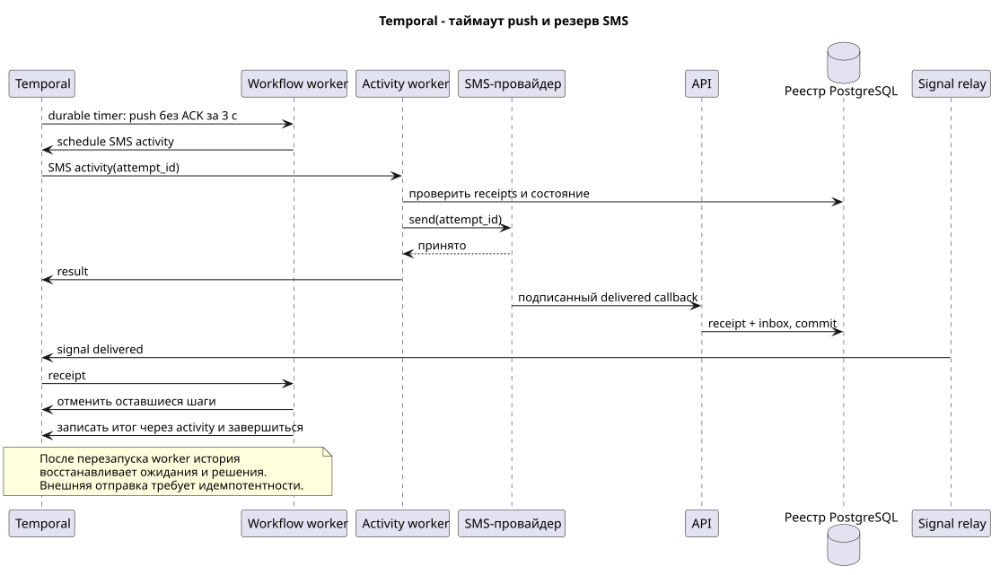

# RFC: Гарантированная доставка критичных уведомлений с кросс-канальным failover

| Метаданные | Значение |
|---|---|
| Статус | DRAFT |
| Автор(ы) | Марченко Александр Владимирович |
| Ответственный | Команда Notification Platform |
| Бизнес-заказчик | Продуктовая команда онлайн-банка |
| Ревьюеры | Архитектор, SRE, команда безопасности - ревью запланировано |
| Дата создания | 2026-11-17 |
| Дата обновления | 2026-11-17 |

## Оглавление

1. [Контекст](#контекст)
2. [Продуктовый анализ](#продуктовый-анализ)
3. [Пользовательские сценарии](#пользовательские-сценарии)
4. [Статистика](#статистика)
5. [Требования](#требования)
6. [Варианты решения](#варианты-решения)
7. [Сравнительный анализ](#сравнительный-анализ)
8. [Выводы](#выводы)
9. [Связанные задачи](#связанные-задачи)
10. [Приложения](#приложения)

## Контекст

Команды банка независимо отправляют уведомления. Задержки, дубли и отсутствие общей истории доставки приводят к жалобам; потеря сообщения о списании мешает вовремя заметить нежелательную операцию.

Notification Platform принимает все транзакционные, сервисные и маркетинговые уведомления и доставляет их через push, SMS и email. Пункты 1-7 задания описаны в требованиях ко всей платформе; варианты решения детализируют подсистему критичной доставки.

Вне рамок RFC: проведение банковских операций, антифрод, выбор аудитории маркетинга и юридическая квалификация обязательных сообщений. Правила отключения ниже - продуктовые допущения, требующие согласования с банком.

## Продуктовый анализ

| Цель | Измерение результата |
|---|---|
| Увеличить retention на 15% | Относительный рост D30 retention: например, с 40% до 46%; сравнение сопоставимых когорт за 3 месяца после запуска |
| Снизить жалобы на 30% | Относительное снижение обращений об уведомлениях на 10 000 активных пользователей за месяц относительно предыдущих 3 месяцев |
| Доставлять критичные сообщения | Доля сообщений с подтверждением доставки в срок; отдельно - неподтверждённые, просроченные и дубли |

Влияние на retention проверяется экспериментом с сервисными/маркетинговыми уведомлениями; критичные сообщения доставляются всем группам. Улучшение технических метрик само по себе не доказывает рост retention.

## Пользовательские сценарии

| Приоритет | Тип | Действующее лицо | Сценарий |
|---|---|---|---|
| MUST | Транзакционный | Клиент | После списания получает одно логическое уведомление; при недоступном push система использует резервный канал |
| MUST | Настройки | Клиент | Отключает маркетинговые и сервисные уведомления, выбирает предпочтительный канал критичных |
| MUST | Интеграция | Команда банка | Передаёт уведомление и видит его итоговый статус, включая причину задержки |
| MUST | Поддержка | Оператор | Находит историю попыток по операции и разбирает недоставку |
| SHOULD | Кампания | Маркетолог | Запускает рассылку на 1 млн пользователей с учётом согласий и частотных ограничений |

## Статистика

Исходные данные: MAU 10 млн, DAU 3 млн, одновременно активны до 300 000 пользователей. Допущение: 2 транзакционных, 3 сервисных и 5 маркетинговых уведомлений в день считаются на DAU. Пиковый коэффициент 10 - гипотеза для нагрузочного теста, а не следствие concurrency.

| Тип | Уведомлений/сутки | Среднее, шт./с | Пик x10, шт./с |
|---|---:|---:|---:|
| Транзакционные | 6 000 000 | 69,4 | 694 |
| Сервисные | 9 000 000 | 104,2 | 1 042 |
| Маркетинговые | 15 000 000 | 173,6 | 1 736 |
| Всего | 30 000 000 | 347,2 | 3 472 |

Рассылка 1 млн за 30 минут добавляет `1 000 000 / 1 800 ~ 556` уведомлений/с. Консервативно считаем её сверх пика: около 4 028/с. Проектная ёмкость приёма - 5 000/с, критичного контура - 1 000 новых уведомлений/с. Push идёт через внешние сервисы; 300 000 пользователей не означают столько же соединений с платформой.

При долях 90% push, 9% SMS и 1% email после последовательного failover на одно критичное сообщение приходится `1 + 0,10 + 0,01 = 1,11` первичных попытки. При полном отказе push и SMS - до 3. Резервируем 3 000 запросов/с критичным адаптерам и до 1 000 SMS/с у провайдеров; повторы используют ту же квоту.

При среднем ожидании 60 с закон Литтла даёт до `1 000 x 60 = 60 000` активных процессов доставки. Суточный отказ при обычных 69,4/с создаёт до 6 млн незавершённых процессов: это отдельный тест ёмкости, а не обычный режим.

Оценка хранения: 1 КБ на сообщение и в среднем 2 записи попыток по 0,5 КБ - около 60 ГБ/сутки для всей платформы, 1,8 ТБ за 30 дней без индексов. Три копии - 5,4 ТБ; с запасом x2 на индексы и служебные данные - около 11 ТБ. История Temporal и RabbitMQ считаются отдельно по результатам прототипа. Для критичных дедупликационные ключи за 90 дней: 540 млн записей; при 100 Б на ключ с индексом - около 54 ГБ на копию.

Если частоты относятся ко всем MAU, нагрузка возрастёт в 3,33 раза: 100 млн/сутки, среднее 1 157/с, пик с кампанией около 12 130/с. Текущий размер кластера этого не обещает; перед запуском нужно уточнить базу расчёта и при необходимости увеличить ёмкость минимум до 15 000/с.

## Требования

### Функциональные требования - пункт 1

MUST - обязательно, SHOULD - желательно. Требования описывают поведение, а не реализацию.

| ID | Приоритет | Требование | Бизнес-цель |
|---|---|---|---|
| FR1 | MUST | Все команды отправляют уведомления трёх типов через единую платформу и получают статус обработки | Контроль, снижение жалоб |
| FR2 | MUST | Критичное уведомление автоматически направляется в резервный канал, если основной отказал или не подтвердил доставку вовремя | Критичная доставка |
| FR3 | MUST | Клиент отключает сервисные и маркетинговые уведомления по типам и каналам; критичные отключить нельзя, предпочтительный канал выбрать можно | Retention, снижение жалоб |
| FR4 | MUST | Повторная передача одной операции не создаёт новое логическое уведомление; после подтверждения доставки новые попытки не назначаются | Снижение дублей и жалоб |
| FR5 | SHOULD | Кампания охватывает до 1 млн получателей без задержки критичных сообщений | Retention, критичная доставка |
| FR6 | MUST | Поддержка видит результат и причины каждой попытки; неподтверждённые критичные сообщения передаются на разбор | Контроль, снижение жалоб |
| FR7 | MUST | Без заданного предпочтения выбирается самый дешёвый доступный канал, обеспечивающий срок и требуемый уровень подтверждения доставки | Устойчивость стоимости |
| FR8 | SHOULD | Маркетинг отправляется только при согласии, не более одного сообщения в сутки и трёх в неделю; с 21:00 до 09:00 местного времени откладывается | Retention, снижение жалоб |

Пять маркетинговых уведомлений на DAU из условия считаются входящими запросами: ограничения FR8 уменьшают фактическую отправку. Ёмкость приёма рассчитывается до фильтрации. Критичные сообщения не откладываются на тихие часы. Предпочтение SMS/email разрешено; клиент не может запретить резервные подтверждённые контакты для критичных сообщений.

### Нефункциональные требования - пункт 2

Все значения - проектные SLO, проверяемые до запуска. Месячные метрики считаются по всем принятым критичным сообщениям, включая сбои провайдеров; исключения не скрываются из знаменателя.

| ID | Приоритет | Измеримое требование |
|---|---|---|
| NFR1 | MUST | За месяц >=99% критичных сообщений получают подтверждение доставки за 5 с, >=99,9% - за 60 с от устойчивого приёма; дополнительно измеряется время от банковского события |
| NFR2 | MUST | Приём доступен >=99,95% за месяц; p99 ответа <=200 мс при 5 000 запросов/с; успешный ответ выдаётся только после устойчивого сохранения |
| NFR3 | MUST | При 5 000 входящих/с, из них 1 000 критичных/с, в течение 30 минут и кампании на 1 млн сохраняется NFR1; кампания передаётся провайдерам за <=30 минут при доступных квотах |
| NFR4 | MUST | При потере одной зоны RPO=0 для принятых сообщений, RTO<=60 с; для потери региона RPO<=5 минут, RTO<=30 минут, восстановление проверяется ежеквартально |
| NFR5 | MUST | За 90 дней повтор одного бизнес-ключа создаёт ровно одно логическое уведомление; 100% попыток имеют стабильный ключ; наблюдаемые межканальные дубли <=0,1% критичных сообщений за месяц |
| NFR6 | MUST | 100% переходов имеют notification_id и запись аудита; алерт о росте доли неподтверждённых за 60 с выше 0,1% в 5-минутном окне приходит дежурному за <=2 минуты |
| NFR7 | MUST | 100% внешних соединений шифруются, доступ к контактам ограничен ролями; в логах нет полных контактов и текста; 100% callback проходят проверку подписи и защиту от replay |
| NFR8 | SHOULD | При доступном push, без явного предпочтения SMS/email, доля SMS <=10% за месяц; достижение NFR1 приоритетнее экономии |

NFR1 зависит от доступности хотя бы одного контакта и канала; 99,9% - целевой уровень, а не обещание 100% при любых отказах. RTO из NFR4 не отменяет учёт нарушений NFR1 во время восстановления.

### ASR и архитектурные последствия - пункты 3 и 5

| ASR | Приоритет | Связь | Почему влияет и какие последствия |
|---|---|---|---|
| ASR1: скорость и изоляция нагрузки | P0 | FR2, FR5; NFR1-3 | Массовая очередь может задержать платёжное сообщение: нужны отдельные очереди, worker pools и квоты провайдеров для критичных сообщений, горизонтальное масштабирование |
| ASR2: сохранность и восстановление | P0 | FR1, FR2, FR6; NFR2, NFR4 | Состояние должно пережить падение процесса: устойчивое принятие, репликация между зонами, сохраняемые таймеры, повторная обработка и сверка потерянных статусов |
| ASR3: идемпотентность и согласованность | P0 | FR4; NFR5 | Таймаут не доказывает отказ: нужен один владелец перехода, уникальные ключи, дедупликация входа и callback; внешнее exactly-once без поддержки провайдера недостижимо |
| ASR4: политика каналов и стоимость | P1 | FR3, FR7, FR8; NFR8 | Нужны версионированные настройки и маршруты, проверка контактов перед отправкой, ограничения частоты и метрики цены |
| ASR5: наблюдаемость и защита данных | P0 | FR6; NFR6, NFR7 | Нужны журнал попыток, корреляция событий, алерты, защищённый приём callback и хранение контактов отдельно от очередей |

### Ключевые архитектурные вопросы - пункт 4

| Вопрос | Источник | Почему важен |
|---|---|---|
| Что подтверждает доставку и когда переключать канал? | FR2; ASR1-3 | Ответ провайдера о приёме не означает получение клиентом; неверный критерий скрывает потери либо создаёт дубли |
| Кто хранит состояние и разрешает следующий шаг? | FR4; ASR2-3 | Параллельные timeout и callback не должны порождать независимые SMS |
| Как отделить кампании от критичного потока? | FR5; ASR1 | Приоритет внутри общей очереди не устраняет конкуренцию за БД, workers и внешние квоты |
| Где граница между экономией, настройками и надёжностью? | FR3, FR7; ASR4 | Запрет дорогого резерва может сорвать доставку, игнорирование предпочтений - увеличить жалобы |

### Решения, которые не подходят - пункт 6

| Решение | Нарушаемый ASR | Причина |
|---|---|---|
| Синхронно отправлять из сервиса перевода и хранить таймер в памяти | ASR1, ASR2 | Сбой провайдера задержит банковскую операцию, перезапуск потеряет ожидание и повтор |
| Одна FIFO-очередь и общий пул на кампании и транзакции | ASR1 | Миллион рекламных сообщений блокирует критичные и расходует их квоты |
| Одновременно отправлять push, SMS и email каждому | ASR3, ASR4 | Дубли создаются намеренно, SMS оплачивается даже при работающем push |

### Неопределённости и риски - пункт 7

| Неизвестно | Проверка | Действие по результату |
|---|---|---|
| Частоты считаются по DAU или MAU, каков реальный пик? | Снять распределение событий за 14 дней, повторить суточный профиль в нагрузочном тесте | Уточнить ёмкость и квоты |
| Приходят ли push ACK и SMS delivery report за выбранные 5/60 с? | Пилот на тестовых устройствах iOS/Android, затем согласованная малая когорта; измерить p99 и потери ACK | Настроить таймеры, уточнить достижимость SLO |
| Поддерживает ли провайдер idempotency/status lookup и сколько хранит ключ? | Контрактные испытания: оборвать соединение после приёма, повторить запрос, отправить дубли callback | Выбирать провайдера с нужными свойствами; иначе зафиксировать риск дублей |
| Насколько независимы SMS-провайдеры и контакты пользователей? | Проверить операторов, маршруты и долю подтверждённых контактов; провести сценарий общего отказа | Добавить независимый маршрут, просить обновить контакты |
| Допустимы ли неотключаемые сообщения и выбранные сроки хранения? | Согласование с продуктом, безопасностью и юридической командой | Скорректировать политику до запуска |
| Выдержит ли хранилище 6 млн ожидающих доставок? | Суточный отказ каналов и восстановление под нагрузкой | Изменить партиционирование, квоты и скорость разгрузки |

## Варианты решения

### Общий контракт гарантированной доставки

**Граница гарантии.** После успешного приёма платформа сохраняет сообщение, выполняет повторы и failover, пока не получит подтверждение либо не передаст недоставку в явный разбор. Доставка хотя бы одним каналом возможна при доступности канала и корректного контакта в пределах срока обработки. Если все каналы недоступны, пользователь офлайн или контакты неверны, физическое получение гарантировать нельзя. Региональная катастрофа имеет отдельный RPO, поэтому сквозная сверка с источником обязательна.

**Восстановление.** В обоих вариантах критичные PostgreSQL-кластеры, включая реестр и persistence Temporal, используют синхронную реплику в другой зоне и автоматическое переключение с блокировкой прежнего primary. Для отказа региона предусматриваются тёплый резерв, асинхронная репликация БД и архив WAL в другом регионе; лаг контролируется относительно RPO 5 минут. При переключении старый регион изолируется от отправки, затем восстанавливаются состояния и сверяются события источников. Очереди RabbitMQ восстанавливаются из outbox, Temporal продолжает работу по сохранённой истории. Достижимость RTO 30 минут проверяется учениями; при потере последних receipts возможны повторные внешние отправки, поэтому до повторов запрашивается статус провайдера.

**Что считается подтверждением:**

- Push: авторизованный ACK приложения о получении сообщения; ответ FCM/APNs означает только приём запроса. При отсутствии ACK используется резерв.
- SMS: delivery report со статусом доставки на устройство, согласно контракту провайдера.
- Email: подтверждение принятия почтовым сервером адресата. Это более слабая гарантия: папка "Входящие", показ и прочтение неизвестны.

Эти уровни сохраняются отдельно в `delivery_evidence`; общая метрика "доставлено" означает транспортную доставку указанного уровня, а не прочтение. Если бизнес требует именно получение человеком, email не закрывает этот критерий и нужна отдельная процедура подтверждения. Различие между принятием и доставкой push описано в [документации FCM](https://firebase.google.com/docs/cloud-messaging/customize-messages/setting-message-lifespan).

**Приём и данные.** Банковский сервис сохраняет событие в своём transactional outbox вместе с операцией; повторяет передачу до успешного ответа. Платформа одной транзакцией сохраняет `notification` и свой outbox. Уникальность: `(source, event_id, recipient_id, notification_kind)`; другой payload с тем же ключом отвергается. Ключи хранятся 90 дней, автоматический replay более старых событий запрещён. Ежедневная сверка с источниками выявляет пропуски, включая последствия восстановления региона; источник хранит события минимум 90 дней.

Запись уведомления содержит ID, ссылку на событие, тип, получателя, версию политики, состояние, deadline и версию записи. Попытка содержит канал, провайдера, стабильный `attempt_id`, внешний ID, timestamps, исход и стоимость. Тела и контакты хранятся зашифрованно отдельно; в очередях и workflow передаются ссылки. Операционный журнал - 30 дней, обезличенный аудит - 90 дней; сроки являются проектным допущением.

**Выбор каналов.** По умолчанию push -> SMS -> email: сначала каналы с подтверждением получения устройством, среди них - более дешёвый push. Email дешевле SMS, но подтверждает только приём сервером адресата, поэтому используется последним как резерв с более слабым доказательством доставки. Явное предпочтение ставится первым, остальные доступные каналы сохраняют этот порядок; отсутствующие/отозванные контакты пропускаются. Маршрут фиксируется версией политики, но перед каждой попыткой актуально проверяются контакты и запреты. При недоступном сервисе настроек используется последняя подтверждённая версия для критичных; без неё отправка откладывается с алертом. Сервисные и маркетинговые сообщения ждут проверки согласия.

**Таймеры.** HTTP timeout провайдера - 2 с. Первый канал начинается сразу; ожидание доказательства доставки: push до 3 с, SMS до 20 с, email до 20 с. Это бюджеты от начала попытки, включая HTTP-запрос, а не дополнительные интервалы. При явном отказе переключение немедленное. В любом порядке сумма ожиданий <=43 с, оставшиеся 17 с из 60 - бюджет внутренних очередей, обработки и повторов. Порог 3 с проверяется пилотом: слишком короткое ожидание увеличивает SMS и дубли.

**Повторы.** После исчерпания маршрута сохраняется `UNCONFIRMED`, алерт не позднее 60 с. Затем повторная сверка и попытки с backoff 1, 5, 15 минут и далее раз в час с jitter до 24 часов, с проверкой общего rate limit. После 24 часов - `ESCALATED`, задача поддержки и сохранение сообщения для ручного разбора; это недоставка, а не успех. Позднее подтверждение обновляет результат на `DELIVERED_LATE`, не стирая нарушение SLO. Новая попытка после доказанного отказа получает новый ID, сетевой повтор неопределённой попытки сохраняет прежний ID.

**Состояния.** `ACCEPTED -> PENDING -> SENDING -> WAITING_RECEIPT -> DELIVERED`. Отказ/таймаут ведёт к следующему каналу или `UNCONFIRMED -> ESCALATED`. Статусы `ACCEPTED` у провайдера и `DELIVERED` платформы различаются. Подтверждение любой предыдущей попытки прекращает назначение новых; callback не может вернуть доставленное сообщение в ошибку. Подтверждения сохраняются даже после эскалации.

**Дубли.** Переходы сериализуются по notification_id, перед внешним вызовом повторно проверяется итоговое состояние. Callback дедуплицируется по ID события провайдера. Провайдеру передаётся attempt_id как idempotency key; при таймауте сначала запрашивается статус, если такой API доступен. На клиенте push отображается один раз по notification_id, TTL push ограничен бюджетом его попытки.

Остаётся гонка: push уже показан, ACK задержался, SMS уже отправлена. Ни блокировка БД, ни Temporal не могут атомарно отменить внешний показ и отправку. TTL и отмена - best effort. Поэтому гарантируется одно логическое уведомление и отсутствие лишних назначений после известного подтверждения, но не абсолютное отсутствие физических межканальных дублей. NFR5 задаёт измеримый бюджет; неполноту наблюдений проверяют пилотом и обращениями.

**Отказ провайдера.** Circuit breaker открывается при >=50% ошибок в >=20 запросах за 10 с; проверка восстановления через 30 с. Для SMS доступны два независимых провайдера. При доказанном отказе можно выбрать второго в пределах бюджета SMS; при неизвестном исходе переход между провайдерами также несёт риск дубля. Ограничители скорости и отдельные квоты не позволяют кампании занять резерв критичной доставки. Бюджет стоимости вызывает алерт и остановку маркетинга, но не блокирует критичные сообщения.

### Вариант 1: RabbitMQ и собственный автомат доставки

#### Архитектура

Go API и workers, PostgreSQL с синхронной репликой в другой зоне, RabbitMQ с quorum queues на трёх узлах в трёх зонах. Источник состояния - PostgreSQL; workers обновляют его условным переходом по версии. Планировщик читает `next_attempt_at` через `FOR UPDATE SKIP LOCKED`, выдаёт lease и пишет outbox в той же транзакции. Сетевой вызов выполняется вне транзакции, истёкшие lease восстанавливаются. Версии защищают локальное состояние от устаревшего worker; внешний эффект защищается ключом провайдера.

Outbox relay публикует persistent сообщения с mandatory routing и publisher confirms; повторная публикация безопасна. Consumer подтверждает сообщение после фиксации результата/следующего шага. Планировщик и сверка поднимают зависшие записи даже при утрате очереди. Publisher confirms и consumer ACK отвечают за разные участки, а не за получение пользователем ([RabbitMQ](https://www.rabbitmq.com/docs/confirms)).

Критичные и массовые потоки имеют отдельные RabbitMQ-кластеры, worker pools и БД состояния. Настройки общие, с кешем по версии. Таблицы попыток партиционируются по дню, активные уведомления - по хешу ID. Критичный RabbitMQ использует [quorum queues](https://www.rabbitmq.com/docs/quorum-queues).

[PlantUML](diagrams/rabbitmq-container.puml)

Основной сценарий:

[PlantUML](diagrams/rabbitmq-delivery.puml)

Failover:

[PlantUML](diagrams/rabbitmq-failover.puml)

#### Этапы реализации

| Этап | Срок | Ресурсы | Риски |
|---|---|---|---|
| Приём, outbox, идемпотентность, политики | Недели 1-2 | 2 backend, 1 SRE, 1 QA | Разные ключи событий у команд |
| Автомат, таймеры, три адаптера и callback | Недели 3-5 | Та же команда | Гонки и неизвестный исход HTTP |
| Fault injection, нагрузка, пилот | Недели 6-7 | Та же команда + безопасность на ревью | Пределы БД и квоты SMS |

#### Преимущества

- Прозрачное состояние в SQL, знакомая инфраструктура при наличии PostgreSQL/RabbitMQ в банке.
- Независимое масштабирование каналов и явный контроль стоимости.

#### Недостатки

- Команда сама реализует таймеры, lease, восстановление и корректность гонок.
- Частые обновления активных записей и сканирование просроченных шагов нагружают БД.

### Вариант 2: Temporal и устойчивые workflow

#### Архитектура

Go API сохраняет вход и outbox в PostgreSQL. Starter запускает Temporal workflow с `workflow_id=notification_id`; запрещены повторный запуск завершённого ID и параллельный конфликтующий запуск. Повтор starter после падения безопасен. Внешний дедупликационный реестр остаётся необходимым после удаления истории workflow.

Self-hosted Temporal в трёх зонах использует отдельный PostgreSQL-кластер для persistence. Один workflow управляет одним критичным уведомлением; activities вызывают адаптеры, таймеры ограничивают ожидания, signals передают receipt. Отдельный RabbitMQ-контур обслуживает сервисные и маркетинговые сообщения; в критичном контуре брокером заданий выступают task queues Temporal.

Workflow является источником состояния исполнения, SQL - идемпотентным реестром и проекцией для поддержки. Callback сначала сохраняется в SQL inbox, затем relay повторяет signal до подтверждения. Receipt, пришедший до старта workflow, не теряется. Закрытые workflow получают поздний receipt через проектор аудита без повторного запуска отправки. Каждая activity сверяет сохранённые receipts перед внешним вызовом.

[История Temporal](https://docs.temporal.io/encyclopedia/event-history) восстанавливает выполнение, но внешние [activities должны быть идемпотентными](https://docs.temporal.io/activity-definition). Настраиваются явные таймауты и retry budgets, иначе автоматические повторы могут выйти за 60 с. Неопределённый ответ отправки возвращается в workflow как `UNKNOWN` для сверки/failover, а не запускает бесконтрольный повтор send. Версии workers закрепляются за выполняющимися workflow; перед обновлением проверяется replay историй.

[PlantUML](diagrams/temporal-container.puml)

Основной сценарий:

[PlantUML](diagrams/temporal-delivery.puml)

Failover:

[PlantUML](diagrams/temporal-failover.puml)

#### Этапы реализации

| Этап | Срок | Ресурсы | Риски |
|---|---|---|---|
| Прототип Temporal и профиль нагрузки | Неделя 1 | 2 backend, 1 SRE, 1 QA | Неизвестная стоимость истории |
| Приём, workflow, activities, callback inbox | Недели 2-4 | Та же команда | Retry и несовместимость replay |
| Fault injection, HA, пилот | Недели 5-6 | Та же команда + безопасность на ревью | Эксплуатационная зрелость Temporal |

#### Преимущества

- Таймеры и восстановление исполнения предоставляет workflow engine.
- Последовательность failover выражена в одном процессе, проще разбирать незавершённые доставки.

#### Недостатки

- Новый инфраструктурный компонент, требования к детерминизму и обновлению workers.
- При 6 млн workflow/сутки объём истории и persistence может стать дороже собственного автомата.
- Temporal не обеспечивает exactly-once во внешних SMS/email-системах.

## Сравнительный анализ

### Ресурсные требования

Оценки сроков предварительные, предполагают доступные контракты провайдеров и SDK приложения с ACK.

| Критерий | Вариант 1 | Вариант 2 |
|---|---|---|
| Время | 7 недель | 6 недель при успешном прототипе |
| Команда | 2 backend, 1 SRE, 1 QA | Такой же состав, нужна компетенция Temporal |
| Инфраструктура | Go, RabbitMQ, PostgreSQL; три зоны | Go, Temporal, отдельная persistence PostgreSQL; три зоны |
| Общее | Отдельный массовый контур, настройки, аудит, мониторинг | То же |
| Основная сложность | Корректность своего автомата и scheduler | Эксплуатация и версия workflow |
| Стоимость | Меньше компонентов, больше собственного кода | Больше инфраструктуры и истории, меньше кода восстановления |

### Соответствие требованиям и ASR

Это проектное соответствие; производительность должна быть подтверждена испытаниями.

| ASR / требования | Вариант 1 | Вариант 2 |
|---|---|---|
| ASR1 - FR2, FR5; NFR1-3 | Выделенные quorum queues, workers, БД и квоты; scheduler lag <=200 мс на тесте | Выделенные Temporal task queues и workers; schedule-to-start p99<=200 мс на тесте |
| ASR2 - FR1, FR2, FR6; NFR2, NFR4 | Outbox, синхронная реплика, persistent таймеры, lease recovery и сверка | Outbox/inbox, HA persistence, история workflow, durable timers и сверка |
| ASR3 - FR4; NFR5 | Unique key, CAS/lease, receipt inbox, idempotency провайдера | Unique key, единственный workflow ID, последовательные решения, идемпотентные activities |
| ASR4 - FR3, FR7, FR8; NFR8 | Общая политика, актуальная проверка настроек, частотные лимиты и cost metrics | Та же политика в activities; версия маршрута в workflow |
| ASR5 - FR6; NFR6, NFR7 | SQL-аудит, OTel, проверка callback, RBAC | История workflow + SQL-проекция, OTel, те же средства защиты |
| Ограничения | Внешние дубли возможны, SLO зависит от каналов | Те же ограничения; Temporal их не устраняет |

### Компромиссы стоимости и надёжности

При условных тарифах push~0, SMS=3 руб., email=0,02 руб. и распределении 90/9/1 средняя цена составляет `0,10 x 3 + 0,01 x 0,02 = 0,3002 руб.` за критичное уведомление, около 1,80 млн руб./сутки для 6 млн сообщений. Это модель, не тариф провайдера; инфраструктура и повторы не включены. SMS всем стоила бы 18 млн руб./сутки. Пользовательское предпочтение SMS и отказ push увеличат расходы; приоритетом остаётся доставка.

Из вероятностей отказа нельзя перемножением получить достоверный SLO без проверки независимости: push и SMS могут одновременно быть недоступны из-за устройства или сети пользователя. Сокращение ожидания push улучшает время failover, но повышает расходы и риск дублей. Поэтому 3 с - начальная настройка с проверкой по данным пилота.

## Выводы

Рекомендуется вариант 2, Temporal: для критичной подсистемы основная сложность - устойчивые ожидания, повторы и гонки, а не само помещение сообщения в очередь. Готовый механизм восстановления снижает объём собственного кода, который нужно доказывать корректным.

Выбор условен: за неделю прототип должен подтвердить 1 000 новых критичных workflow/с, 60 000 одновременно ожидающих процессов, восстановление при отказе зоны и приемлемую стоимость хранения при 6 млн workflow/сутки. При провале этих критериев или отсутствии компетенции эксплуатации выбирается вариант 1 с отдельным тестированием автомата и таймеров.

Принимаются компромиссы: дополнительная инфраструктура, возможный рост SMS при сбоях, редкие физические дубли и отсутствие гарантии прочтения. Потери и неподтверждённые доставки нельзя маскировать статусом "отправлено".

## Связанные задачи

| Задача | Критерий готовности |
|---|---|
| Согласовать правила и метрики | Утверждены отключения, определения delivery evidence, DAU/MAU, retention и сроки хранения |
| Проверить провайдеров и мобильный ACK | Измерены latency/coverage, идемпотентность, delivery reports и независимость маршрутов |
| Выполнить нагрузочный прототип | 5 000 входящих/с, 1 000 критичных/с, кампания 1 млн, проверка NFR1-3; отдельно суточный outage backlog |
| Проверить отказы | Падение до/после commit и send, повтор/перестановка callback, поздний ACK, отказ зоны, недоступность всех каналов; нет потерь в пределах RPO |
| Проверить гонки | Одновременные timeout/receipt, перезапуск и replay не создают новый логический ID; внешние дубли измеряются отдельно |
| Проверить безопасность | Поддельный/replayed callback отклонён; контакты и текст отсутствуют в логах; доступ проверен по ролям |
| Включить пилот | 1% -> 10% -> 100% источников, каждый этап >=7 дней; контроль SLO, цены и жалоб |
| Подготовить откат | Остановить новый приём от выбранного источника, завершить принятые workflow; вернуть источник на прежний маршрут с общим реестром ключей, без двойной отправки |

## Приложения

### Глоссарий

| Термин | Определение |
|---|---|
| ASR | Требование, существенно определяющее архитектуру |
| SLO | Измеримая цель качества сервиса |
| RPO / RTO | Допустимая потеря данных по времени / время восстановления |
| Outbox / inbox | Устойчивые записи исходящих / входящих событий для безопасного повтора |
| Failover | Автоматическое переключение на резервный канал или провайдера |
| ACK / receipt | Подтверждение с явно определённым уровнем доставки |
| CAS / lease | Условное обновление по версии / временное владение заданием |
| At-least-once | Повторяемая обработка с возможностью дублей |

### Соответствие заданию

| Пункт | Раздел |
|---|---|
| 1 | Функциональные требования: FR1-FR8 |
| 2 | Нефункциональные требования: NFR1-NFR8 |
| 3, 5 | ASR и архитектурные последствия: ASR1-ASR5 |
| 4 | Ключевые архитектурные вопросы |
| 6 | Решения, которые не подходят |
| 7 | Неопределённости и риски |
| 8 | RFC целиком; два C4 Container и четыре sequence-диаграммы PlantUML |
